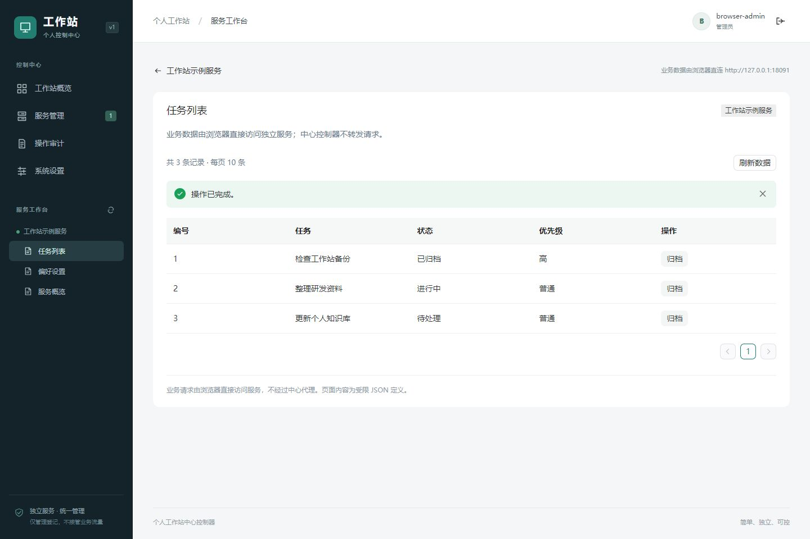
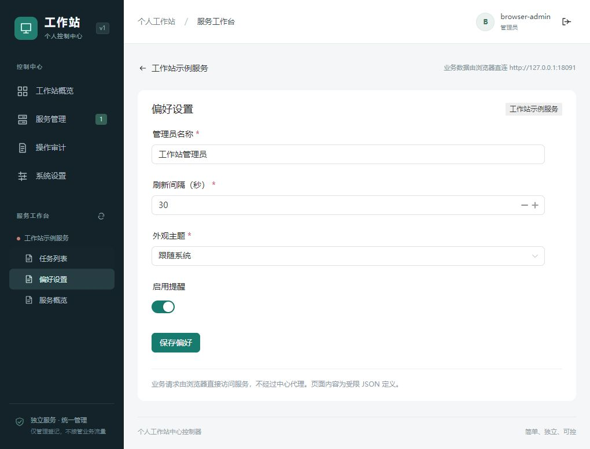
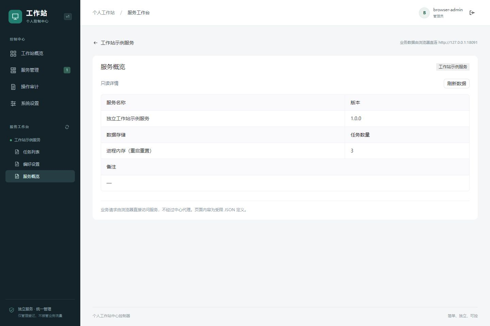
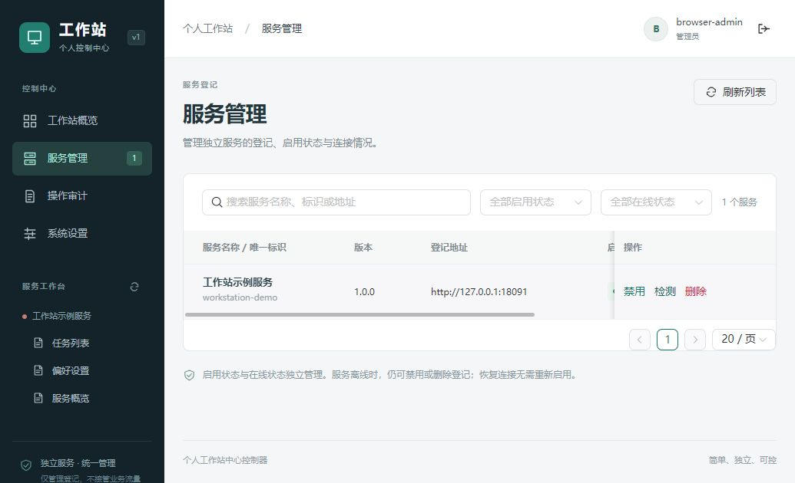

# 本次更新说明

2026-10-23：新增受限业务网关、独立业务令牌与来源IP鉴权，并调整品牌配色。按用户要求，本次未运行自动化测试、安全测试或浏览器验收。以下是此前版本的历史记录，不代表当前网关改动已经通过验证。

# 测试与验收记录

验收日期：2026-10-23（Asia/Shanghai）。所有下列结果均来自实际执行；临时数据库与正式数据隔离。

## 基础构建

| 检查 | 结果 |
| --- | --- |
| `go test ./...` | 通过，包含认证、配置、HTTP、注册协议、网络检查、数据访问及演示服务测试 |
| `go vet ./...` | 通过 |
| `docker build --target backend-test .` | 通过；隔离Linux构建阶段执行 `CGO_ENABLED=1 go test -race ./internal/...`，所有有测试的内部模块通过 |
| Windows中心及示例服务编译 | 通过，进程级集成脚本自动编译并启动 |
| `CGO_ENABLED=0 GOOS=linux GOARCH=amd64 go build ./cmd/controller` | 通过 |
| `npm test` | 8个测试文件、54项测试通过 |
| `npm run build` | Vue类型检查和Vite生产构建通过 |
| `docker build -t workstation-controller:local .` | 通过，最终运行镜像约24.6 MB，用户65532 |
| `docker compose config --quiet` | 通过；已指定固定项目名以支持中文目录 |

前端使用TypeScript5.9.3与当前Vue类型工具兼容，依赖版本及完整性锁定于 `web/package-lock.json`。

本机Windows的额外 `go test -race` 重跑在GCC外部链接阶段失败（普通Go测试和静态构建通过）。最终竞态检查改在上述Linux隔离阶段执行并通过；该测试阶段的C编译器不会进入最终运行镜像。

## 真实进程级集成验收

运行 `node scripts/integration.mjs`，最新结果为 **15组全部通过**。结果文件：`.runtime/integration-bcyrzF/result.json`。

脚本实际编译并启动Go中心、独立演示服务，以随机端口和临时SQLite数据库完成：

1. 未登录不能访问管理接口。
2. 初始化校验独立令牌、仅成功一次。
3. 登录失败处理、HttpOnly/SameSite会话及CSRF校验。
4. 演示服务主动注册，中心自动出现待启用记录。
5. table/form/detail定义持久化，仪表盘真实计数。
6. 管理员启用，健康检查上线。
7. 相同id重复登记不重复建记录，不改变启用状态。
8. 拒绝错误注册密钥、未知版本、非法地址、无效页面、畸形/过大JSON，保留旧有效定义和错误事件。
9. 独立业务API真实分页、行操作、表单保存、详情、CORS；不存在中心业务代理接口。
10. 停止独立进程后，中心仍正常，登记离线且仍已启用。
11. 恢复独立进程后，重新检测上线，无需重新启用。
12. 已禁用服务重复注册不能自动启用。
13. 离线可禁用/删除；删除后再次登记回到待启用。
14. 系统设置、审计和秘密不回传；重启中心后SQLite、管理员、会话、登记与设置保留。
15. 登出撤销会话。

## 组件与安全回归

- 真实Naive UI挂载的表格、分页、操作确认、表单校验、失败重试和只读详情。
- HTML/脚本内容作为文本；无效定义零业务请求；禁止危险属性、跨源路径与重定向。
- 业务请求不带凭据、超时/大小限制、切页取消、旧响应不污染新页面。
- 离线服务操作、删除必须确认、动态菜单保持独立启用/在线状态、会话失效清理和并发会话恢复。
- 后端来源白名单、DNS固定拨号、忽略环境代理、危险地址/混合DNS/重定向拒绝。
- 并发登记唯一性、健康检查期间删除不复活记录、过期结果不覆盖新登记、审计与状态更新的事务回滚。
- 慢健康检查期间，仪表盘与删除接口保持可用。

## 真实浏览器验收

使用单独临时实例 `127.0.0.1:18080` 和演示服务 `127.0.0.1:18091`，已目视并操作验证：

- 初始化界面、测试管理员登录、真实仪表盘与服务管理。
- 启用后自动出现三个服务菜单。
- 表格直连取数、确认后归档并刷新状态。
- 表单提交文本/数字/布尔值，刷新后从独立服务重新读取已保存结果。
- 详情的只读布局和空值占位。
- 服务停止后表单显示局部连接错误，中心管理可访问，记录仍保留已启用状态。
- 服务恢复后重新检测上线，启用状态保持。
- 修复了非必填布尔字段错误显示必填星号的问题。

截图保存在 `docs/screenshots/`：









验收后已结束两个临时本机进程，并关闭临时浏览器标签页。正式管理员没有被测试账户初始化。

## Docker与Compose验收

运行 `powershell -ExecutionPolicy Bypass -File .\scripts\docker-smoke.ps1`，结果文件：`.runtime/workstation-smoke-286a08b56e27/result.json`。

使用随机Compose项目和临时命名卷，已通过：

- Compose正常启动、健康接口可用、Go正确托管Vue构建产物。
- 容器用户65532、只读根目录、内置 `-healthcheck` 成功。
- 容器内初始化管理员成功。
- 强制重建容器后，命名卷中的管理员仍保留。
- 完成后删除了该测试项目的临时容器、网络和数据卷；正式数据卷未受影响。测试卷已删除，无法恢复，但不含用户业务数据。

首次执行发现Windows PowerShell5按默认代码页读取无BOM中文脚本会解析失败，已为两个PowerShell脚本添加UTF-8 BOM，并真实重跑通过。本地初始化脚本已生成被Git和镜像构建忽略的随机配置，未打印密钥。

## 复现

```powershell
go test ./...
go vet ./...
cd web
npm ci
npm test
npm run build
cd ..
node scripts/integration.mjs
docker build -t workstation-controller:local .
docker build --target backend-test .
powershell -ExecutionPolicy Bypass -File .\scripts\docker-smoke.ps1
```

`.runtime/` 中保留的配置和测试数据库含临时凭据，仅用于本机排错，不应提交或分享。未实现和明确不在第一版范围的功能见README末尾。
